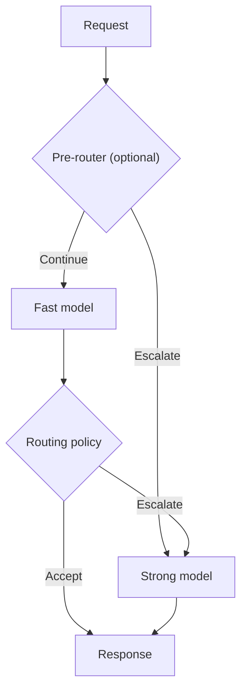

# CascadeOne

**CascadeOne** is a setup of System One decision models arranged in a cascade, designed to optimize resource utilization and reduce response latency compared to a standalone strong model (the higher-capability fallback), while minimizing the loss of decision quality (the performance–quality trade-off).

This is achieved through an appropriate inference engine or architectural modifications, such as introducing a router or an additional decision head.

The core concept is to reduce the average number of calls to the strong System One model during system inference. Depending on the configured routing policy, a request may be handled by the fast model or escalated to the strong model. Escalation can occur before or after the fast model runs.

The term *cascade* refers to conditional escalation: requests that the routing policy considers unsuitable for the fast path are directed to the strong model, either before the fast model runs or after its response is evaluated.

## Quick start

**Benchmark** runs the `fast_only`, `strong_only` and `cascade` paths through the shared inference engine to compare decision quality, latency and escalation.

**Inference** serves the chosen cascade as a single System One model over HTTP, routing requests to the fast or strong model as needed.

See [Main usage modes](#main-usage-modes) for commands, prerequisites and detailed instructions.

## Repository

This repository provides an experimental framework for conditional inference with decision models. It combines a fast, lightweight model with the strong fallback model, using a configurable routing policy to decide when the extra computation is justified.

The goal is to evaluate whether a cascade can reduce **end-to-end response latency and resource utilization** while retaining an acceptable level of decision quality. CascadeOne explores the conditions under which a cascade actually outperforms a standalone strong model on a given workload and hardware platform. The fast model alone may need fewer resources but be less accurate; the strong model alone may produce higher-quality decisions but be slower. Current benchmarks measure latency, Gold-based decision quality when available, escalation rates, and available host-level resource telemetry; they do not directly establish monetary cost or comprehensive compute cost.

## Architecture exploration

CascadeOne investigates alternative model pairings, model-internal modifications, and configurations with additional components to identify tradeoffs between decision quality, latency, and resource utilization.

Experiments can explore distilled or specialized fast models, alternative decision heads and adapters, multiple fast experts, pre-routers, learned escalation or fidelity predictors, and latent-representation fusion. Every additional component has costs in latency, memory, or communication, so the complete execution path must be benchmarked against the same single-model baselines.

Work is in progress. Some concepts are under implementation and research. Not all components have been implemented or validated.

## How it works

1. A request contains one or more typed decision questions.
2. An optional **pre-router** can send the request directly to the strong model.
3. Otherwise the **fast model** evaluates the request once.
4. A **routing policy** accepts that response or escalates the *whole request* to the strong model.
5. The system returns the selected response and records the execution route.

**Confidence is a routing signal, not a guarantee of correctness.** The built-in confidence policy accepts a configurable threshold and minimum, mean or maximum aggregation across questions. Other built-in policies include an input-based question-count pre-router, always-fast and always-strong. Trusted Python policy plug-ins can implement additional strategies. Routing and inference execution remain separate from benchmark measurement.

## What is included

- **Two reference cascades:** [Laya → Clef](cascades/laya-clef/README.md) and [Basal Pico → Ultra](cascades/basal-pico-ultra/README.md), with versioned model configurations and Docker Compose definitions.
- **A policy-driven cascade runtime:** [cascades/runtime.py](cascades/runtime.py) and [cascades/policies.py](cascades/policies.py).
- **Local inference API:** [inference/](inference/README.md) serves a configured cascade through one System One endpoint, with validated benchmark-based startup warnings.
- **A source dataset registry:** [datasets/](datasets/README.md) acquires immutable, pinned source files and verifies SHA-256. It does not silently filter, split or transform them.
- **Reproducible benchmarks:** [benchmarks/](benchmarks/README.md) defines the dataset and selection, model pair, routing strategy and source-to-request adapter for each experiment.
- **Measurements and validation:** the benchmark runner records quality, latency, escalation, environment and provenance; [tools/validate_result.py](tools/validate_result.py) validates generated run artifacts.

Each named benchmark compares **three arms on the same requests**: `fast_only` (fast model), `strong_only` (strong model), and `cascade` (fast model plus routing and optional fallback). This comparison is essential: the percentage handled by the fast model alone is not a measure of acceleration or decision quality.

The dataset is independent of its benchmark. Normalization, Gold interpretation and selection belong to the benchmark configuration. Offline dataset preparation is recorded but excluded from timed per-request inference; runtime preprocessing, routing and fallback overhead are measured.

Model identity alone is not a complete execution profile: cascade definitions pin model revisions and declare backend implementations, software versions and execution modes. Benchmark manifests retain those declarations alongside runtime identity evidence and the shared inference engine version.

## Main usage modes

CascadeOne has **two main usage modes**. Both use the same inference engine
and the same cascade definition (`cascades/<pair>/benchmark.json`).

| Mode | Purpose | Entry point |
| --- | --- | --- |
| **Benchmark** | Measure decision quality, latency and escalation against `fast_only` and `strong_only` on identical requests. | [Benchmark framework](benchmarks/README.md) |
| **Inference** | Serve a selected cascade as **one logical System One model** for applications. | [Local inference API](inference/README.md) |

### 1. Benchmark — evaluate a cascade

Each named benchmark executes **three arms** through the shared inference
service: `fast_only` (fast model only), `strong_only` (strong model only)
and `cascade` (conditional execution). It reports both client-observed
**end-to-end HTTP latency** and **engine-internal latency**, as well as
per-backend HTTP time, Gold-based quality where available, and escalation.
The engine-internal time includes backend HTTP communication; it is
**not** a pure GPU compute measurement.

For a live Laya → Clef smoke run, start from the repository root on a
compatible NVIDIA ARM64 GPU host. Set `CASCADEONE_CUDA_BASE` to a verified
compatible image digest as described in the
[Laya → Clef setup](cascades/laya-clef/README.md).

~~~bash
export CASCADEONE_BENCHMARK_TOKEN="$(openssl rand -hex 32)"
docker compose -f cascades/laya-clef/compose.yaml --profile inference up -d --build fast strong inference
docker compose -f cascades/laya-clef/compose.yaml --profile inference --profile benchmark run --rm benchmark \
  python benchmarks/smoke-general__laya-clef__confidence-min-t0p900000/run.py --repeats 2
python tools/validate_result.py output/benchmarks/smoke-general__laya-clef__confidence-min-t0p900000
~~~

The token is used by the benchmark client and the inference service;
it protects benchmark-only execution modes. **Do not commit it.** This
smoke benchmark verifies integration, not real-world model performance.
Use the other cascade's Compose file and a matching benchmark setup for
Pico → Ultra. See [benchmark setup and execution](benchmarks/README.md)
for dataset acquisition, benchmark suites and methodology. Use a
**new output directory** for each measurement.

### 2. Inference — serve a cascade as one model

The inference service exposes **one System One API**. Applications do not
need to know whether the fast model answered or the request escalated to
the strong model. Start the selected cascade from the repository root:

~~~bash
docker compose -f cascades/laya-clef/compose.yaml --profile inference up -d --build fast strong inference
curl http://127.0.0.1:18358/v1/models
~~~

Send decisions to `POST http://127.0.0.1:18358/v1/systemone`; the service
also provides `GET /health`. The API retains the standard System One
response structure; optional response headers report the route.
See the [request example and API contract](inference/README.md).

At startup, when given a **matching, validated benchmark from the new
shared inference path**, the service displays the cascade's measured
mean latency improvement, internal-engine comparison, p95 and Gold-quality
difference against `strong_only`. It warns when the cascade is not
meaningfully faster or loses too much quality. Without such a benchmark,
the differences are explicitly **unknown**; no performance claim is made.
The optional run is selected with `CASCADEONE_BENCHMARK_RUN` or
`--benchmark` (see [startup comparisons](inference/README.md)).

Both reference deployments require backend model services and compatible
GPU hardware. The Compose configuration binds the public API to
`127.0.0.1:18358` only; the reference API has no authentication or TLS.

## Local checks (no GPU needed)

From the repository root, run the CPU contract tests:

~~~bash
python -m unittest discover -s tests -v
~~~

Inspect source datasets and verify the bundled synthetic sample:

~~~bash
python datasets/catalog.py list
python datasets/catalog.py verify smoke-general-v1
~~~

List available smoke benchmarks or validate an input setup without
starting model services:

~~~bash
python benchmarks/run_confidence_wide.py --suite smoke --list
python benchmarks/smoke-general__laya-clef__confidence-min-t0p900000/run.py --dry-run
~~~

A dry run checks the benchmark's source and normalization; it does
**not** measure inference. Synthetic smoke data must not be used to
claim real-world quality or latency improvements.

## Benchmark datasets

Available named benchmarks are grouped by purpose:

| Group | Setups | Meaning |
| --- | ---: | --- |
| `smoke` | 3 | Bundled synthetic integration checks |
| `source` | 1 | Full n4ze3m training-source benchmark |
| `wide` | 5 | Frozen samples of upstream training sources |
| `external` | 10 | Public BANKING77, CLINC150 and better-jev-bench text evaluations |

To acquire pinned sources, follow [datasets/README.md](datasets/README.md). To execute or inspect benchmark configurations, follow [benchmarks/README.md](benchmarks/README.md). All 19 setups compare the same three arms; baselines are not separate benchmark definitions.

## Interpreting results

CascadeOne measures latency distributions, Gold-based decision quality where available, escalation rates and paired differences against both single-model baselines. The result depends on workload composition, model revision, eligibility, serving configuration and hardware. A training-source evaluation is not an independent holdout; publicly sourced test data may overlap unknown model pretraining corpora.

The current code includes CPU tests and GPU-oriented service definitions, but **full fresh GPU validation and release qualification are still pending**. No model weights or non-redistributable third-party raw datasets are bundled. Check [release readiness](docs/RELEASE-READINESS.md) and dataset/model licenses before publication or redistribution.

## Documentation and contributing

- [Project concept](docs/concept.md) and [architectures](docs/architectures.md)
- [Engineering hypotheses](docs/hypotheses.md)
- [Benchmark protocol](benchmarks/README.md) and [dataset handling](datasets/README.md)
- [Submitting measured runs](CONTRIBUTING.md) and [result format](results/README.md)
