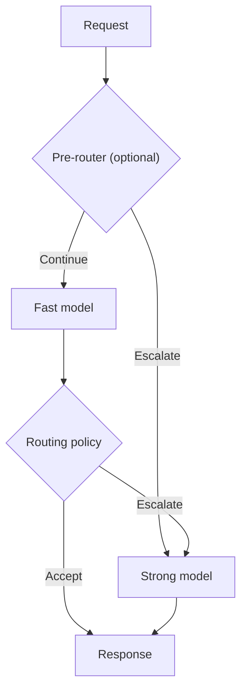

# CascadeOne

**CascadeOne** is a setup of System One decision models arranged in a cascade, designed to optimize resource utilization and reduce response latency compared to a standalone strong model (the higher-capability fallback), while minimizing the loss of decision quality (the performance–quality trade-off).

This is achieved through an appropriate inference engine or architectural modifications, such as introducing a router or an additional decision head.

The core concept is to reduce the average number of calls to the strong System One model during system inference. Depending on the configured routing policy, a request may be handled by the fast model or escalated to the strong model. Escalation can occur before or after the fast model runs.

The term *cascade* refers to conditional escalation: requests that the routing policy considers unsuitable for the fast path are directed to the strong model, either before the fast model runs or after its response is evaluated.

## Quick start

On an **ARM64 NVIDIA GPU** host with Docker Compose v2 and sufficient VRAM, run from the `dist/CascadeOne-Community` repository root. The `./cascadeone` launcher handles Docker startup, dataset acquisition, benchmark authorization and result validation.

~~~bash
# List available cascades, including model pairs and routing (no GPU needed).
./cascadeone cascade list

# List available named benchmarks for a cascade (no GPU needed).
./cascadeone benchmark list --cascade basal-pico-ultra/confidence

# Run the small smoke benchmark for Laya → Clef.
# --cuda-base overrides the NVIDIA image for both backends; this tag is an example.
./cascadeone benchmark smoke --cascade laya-clef/confidence \
  --cuda-base nvcr.io/nvidia/vllm:26.07-py3

# Evaluate Basal Pico → Ultra on one named held-out benchmark.
# No --suite needed: this is a single dataset, not a batch.
./cascadeone benchmark evaluate --cascade basal-pico-ultra/confidence \
  --benchmark better-jev-bench-civil-comments-heldout__basal-pico-ultra__confidence-min-t0p656352

# Optionally run ALL external setups defined for this cascade.
./cascadeone benchmark evaluate --cascade basal-pico-ultra/confidence --suite external

# Optional: supply an API token in the environment (never saved by the launcher).
# Uncomment if you prefer environment-based credentials:
# export CASCADEONE_API_TOKEN="$(openssl rand -hex 32)"

# Start a single public System One API with the selected cascade.
./cascadeone inference start --cascade laya-clef/confidence \
  --cuda-base nvcr.io/nvidia/vllm:26.07-py3
~~~

Omit `--cuda-base` to use the Compose default `nvcr.io/nvidia/vllm:26.07-py3`. This tag is **not** immutable; for strict reproducibility provide an approved, compatible image digest instead. The launcher uses **one API token** for inference and benchmarks: when `CASCADEONE_API_TOKEN` is set, it is used **without reading or writing `.cascadeone/token`**; otherwise the launcher creates/reuses that Git-ignored file with `0600` permissions. `POST /v1/systemone` requires `Authorization: Bearer <token>` in both modes. Benchmark-only endpoints are enabled only during benchmark runs. Run only one reference stack at a time because they share host port `18358`. To supply your own token without writing a token file, export `CASCADEONE_API_TOKEN` before running `./cascadeone`; API calls must include `Authorization: Bearer <token>`. See the [inference API example](inference/README.md#client-api).

See [Main usage modes](#main-usage-modes), [Laya → Clef](cascades/laya-clef/README.md) and [Basal Pico → Ultra](cascades/basal-pico-ultra/README.md).

## Cascade definitions

Each independently launchable variant lives in `cascades/<pair>/<variant>/`, containing its own **`cascade.yaml`** (models, backend revisions, routing policy) and complete **`compose.yaml`** (Docker services). Compose files are not merged or inherited between variants. The launcher starts the services enabled by the chosen variant's Compose file (excluding benchmark-only services), so adding a router service does not require changing launcher source. Model Dockerfile recipes may be shared within a pair, but each variant's service topology is explicit. `./cascadeone cascade list` discovers all valid pair/variant directories, including [Laya → Clef pre-router](cascades/laya-clef/pre-router/cascade.yaml).

Benchmark configurations remain **JSON** (`benchmarks/<benchmark-id>/benchmark.json`), referencing an exact pair/variant YAML path and defining a dataset, adapter and selection. Select a variant with `--cascade laya-clef/pre-router` or `--cascade basal-pico-ultra/confidence`. Run `./cascadeone cascade list` to see all available profiles. The old pair-only `--cascade laya-clef` and `--cascade basal-pico-ultra` names are intentionally replaced by explicit `PAIR/VARIANT` selectors. This local listing command requires Python 3 and PyYAML (`python3 -m pip install PyYAML==6.0.2`); no Docker or GPU is needed. The inference and benchmark Docker images install the pinned YAML parser automatically.

**Reproducibility note:** Converting cascade definitions from JSON to YAML changes their file SHA-256. Existing reports produced with the former JSON files will not match the new definition hashes; rerun benchmarks rather than bypassing the identity check.

## Repository

This repository provides an experimental framework for conditional inference with decision models. It combines a fast, lightweight model with the strong fallback model, using a configurable routing policy to decide when the extra computation is justified.

The goal is to evaluate whether a cascade can reduce **end-to-end response latency and resource utilization** while retaining an acceptable level of decision quality. CascadeOne explores the conditions under which a cascade actually outperforms a standalone strong model on a given workload and hardware platform. The fast model alone may need fewer resources but be less accurate; the strong model alone may produce higher-quality decisions but be slower. Current benchmarks measure latency, Gold-based decision quality when available, escalation rates, and available host-level resource telemetry; they do not directly establish monetary cost or comprehensive compute cost.

## Architecture exploration

CascadeOne investigates alternative model pairings, model-internal modifications, and configurations with additional components to identify tradeoffs between decision quality, latency, and resource utilization.

Experiments can explore distilled or specialized fast models, alternative decision heads and adapters, multiple fast experts, pre-routers, learned escalation or fidelity predictors, and latent-representation fusion. Every additional component has costs in latency, memory, or communication, so the complete execution path must be benchmarked against the same single-model baselines.

Work is in progress. Some concepts are under implementation and research. Not all components have been implemented or validated.

## How it works

1. A request contains one or more typed decision questions.
2. An optional **pre-router** can send the request directly to the strong model.
3. Otherwise the **fast model** evaluates the request once.
4. A **routing policy** accepts that response or escalates the *whole request* to the strong model.
5. The system returns the selected response and records the execution route.

**Confidence is a routing signal, not a guarantee of correctness.** The built-in confidence policy accepts a configurable threshold and minimum, mean or maximum aggregation across questions. Other built-in policies include an input-based question-count pre-router, always-fast and always-strong. Trusted Python policy plug-ins can implement additional strategies. Routing and inference execution remain separate from benchmark measurement.

## What is included

- **Launcher:** [`./cascadeone`](cascadeone) lists YAML cascades with `cascade list`, starts inference or benchmarks, accepts an optional `--cuda-base` and batches tests only when `--suite` is explicitly provided.
- **Three launchable variants of two model pairs:** [Laya → Clef](cascades/laya-clef/README.md) (`confidence`, `pre-router`) and [Basal Pico → Ultra](cascades/basal-pico-ultra/README.md) (`confidence`), each with its own YAML definition and complete Docker Compose file.
- **A policy-driven cascade runtime:** [cascades/runtime.py](cascades/runtime.py) and [cascades/policies.py](cascades/policies.py).
- **Local inference API:** [inference/](inference/README.md) serves a configured cascade through one System One endpoint, with validated benchmark-based startup warnings.
- **A source dataset registry:** [datasets/](datasets/README.md) acquires immutable, pinned source files and verifies SHA-256. It does not silently filter, split or transform them.
- **Reproducible benchmarks:** [benchmarks/](benchmarks/README.md) defines the dataset and selection, model pair, routing strategy and source-to-request adapter for each experiment.
- **Measurements and validation:** the benchmark runner records quality, latency, escalation, environment and provenance; [tools/validate_result.py](tools/validate_result.py) validates generated run artifacts.

Each named benchmark compares **three arms on the same requests**: `fast_only` (fast model), `strong_only` (strong model), and `cascade` (fast model plus routing and optional fallback). This comparison is essential: the percentage handled by the fast model alone is not a measure of acceleration or decision quality.

The dataset is independent of its benchmark. Normalization, Gold interpretation and selection belong to the benchmark configuration. Offline dataset preparation is recorded but excluded from timed per-request inference; runtime preprocessing, routing and fallback overhead are measured.

Model identity alone is not a complete execution profile: cascade definitions pin model revisions and declare backend implementations, software versions and execution modes. Benchmark manifests retain those declarations alongside runtime identity evidence and the shared inference engine version.

## Main usage modes

The same cascade can be evaluated on **many independent datasets**. `--cascade` chooses the model pair and routing profile; `--benchmark` selects one named experiment (dataset, adapter and selection), and `--dataset-id` with `--adapter` allows running a new dataset directly. **`--suite` is optional**: specify it only to execute a batch of named setups. The runner measures `fast_only`, `strong_only` and `cascade` on identical requests.

The two main usage modes are:

- **Benchmark:** `./cascadeone benchmark smoke|evaluate ...`. Measures quality, latency and escalation; a negative speedup or quality regression is a valid result. [Benchmark methodology](benchmarks/README.md).
- **Inference:** `./cascadeone inference start ...`. Exposes one System One HTTP model at `POST /v1/systemone`, with `GET /v1/models` and `GET /health`. [API reference](inference/README.md).

For model-specific command examples and caveats, see [Laya → Clef](cascades/laya-clef/README.md) and [Basal Pico → Ultra](cascades/basal-pico-ultra/README.md). `./cascadeone --help` lists all flags. Datasets remain model-independent and source provenance is recorded in each benchmark run.

## Local checks (no GPU needed)

From the repository root, run the CPU contract tests:

~~~bash
# Run CPU contract tests (no GPU and no model services).
python -m unittest discover -s tests -v
~~~

Inspect source datasets and verify the bundled synthetic sample:

~~~bash
# List registered source datasets.
python datasets/catalog.py list
# Verify the bundled smoke source against its SHA-256.
python datasets/catalog.py verify smoke-general-v1
~~~

List available smoke benchmarks or validate an input setup without
starting model services:

~~~bash
# List named smoke configurations without running inference.
python benchmarks/run_confidence_wide.py --suite smoke --list
# Check source normalization and setup validity without invoking models.
python benchmarks/smoke-general__laya-clef__confidence-min-t0p900000/run.py --dry-run
~~~

A dry run checks the benchmark's source and normalization; it does
**not** measure inference. Synthetic smoke data must not be used to
claim real-world quality or latency improvements.

## Benchmark datasets

Available named benchmarks are grouped by purpose:

The **Setups** column counts named benchmark configurations (dataset, adapter, selection, cascade and routing policy), not distinct datasets.

| Group | Setups | Meaning |
| --- | ---: | --- |
| `smoke` | 3 | Bundled synthetic integration checks |
| `source` | 1 | Full n4ze3m training-source benchmark |
| `wide` | 5 | Frozen samples of upstream training sources |
| `external` | 10 | Public BANKING77, CLINC150 and better-jev-bench text evaluations |

To acquire pinned sources, follow [datasets/README.md](datasets/README.md). To execute or inspect benchmark configurations, follow [benchmarks/README.md](benchmarks/README.md). All 19 setups compare the same three arms; baselines are not separate benchmark definitions.

## Interpreting results

CascadeOne measures latency distributions, Gold-based decision quality where available, escalation rates and paired differences against both single-model baselines. The result depends on workload composition, model revision, eligibility, serving configuration and hardware. A training-source evaluation is not an independent holdout; publicly sourced test data may overlap unknown model pretraining corpora.

The current code includes CPU tests and GPU-oriented service definitions, but **full fresh GPU validation and release qualification are still pending**. No model weights or non-redistributable third-party raw datasets are bundled. Check [release readiness](docs/RELEASE-READINESS.md) and dataset/model licenses before publication or redistribution.

## Documentation and contributing

- [Project concept](docs/concept.md) and [architectures](docs/architectures.md)
- [Engineering hypotheses](docs/hypotheses.md)
- [Benchmark protocol](benchmarks/README.md) and [dataset handling](datasets/README.md)
- [Submitting measured runs](CONTRIBUTING.md) and [result format](results/README.md)
