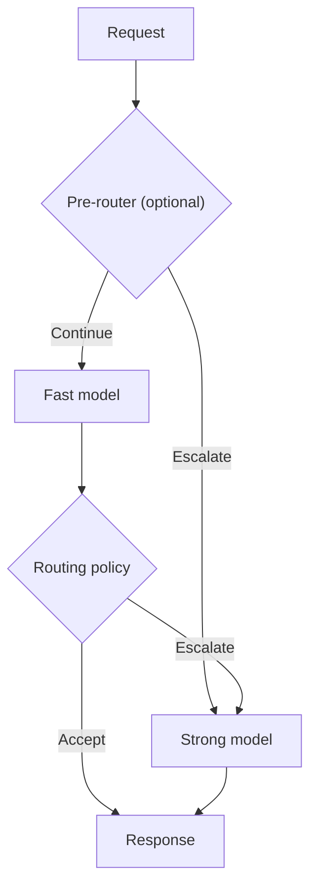

# CascadeOne

**CascadeOne** is a system of System One decision models arranged in a cascade, designed to optimize resource utilization and reduce response latency compared to a standalone large model, while minimizing the loss of decision quality (the performance–quality trade-off).

This is achieved through an appropriate inference engine or architectural modifications, such as introducing a router or an additional decision head.

The core concept is to reduce the average number of calls to the large System One model during system inference. Depending on the configured routing policy, a request may be handled by a smaller model or escalated to a larger one. Escalation can occur before or after the smaller model runs.

The term *cascade* refers to conditional escalation: requests that the routing policy considers unsuitable for the fast path are directed to the larger model, either before the smaller model runs or after its response is evaluated.

## Repository

This repository provides an experimental framework for conditional inference with decision models. It combines a fast, lightweight model with a stronger fallback model, using a configurable routing policy to decide when the extra computation is justified.

The goal is to evaluate whether a cascade can reduce **end-to-end response latency and resource utilization** while retaining an acceptable level of decision quality. CascadeOne explores the conditions under which a cascade actually outperforms a standalone strong model on a given workload and hardware platform. A smaller model alone may need fewer resources but be less accurate; a stronger model alone may produce higher-quality decisions but be slower. Current benchmarks measure latency, Gold-based decision quality when available, escalation rates, and available host-level resource telemetry; they do not directly establish monetary cost or comprehensive compute cost.

## Architecture exploration

CascadeOne investigates alternative model pairings, model-internal modifications, and configurations with additional components to identify tradeoffs between decision quality, latency, and resource utilization.

Experiments can explore distilled or specialized fast models, alternative decision heads and adapters, multiple fast experts, pre-routers, learned escalation or fidelity predictors, and latent-representation fusion. Every additional component has costs in latency, memory, or communication, so the complete execution path must be benchmarked against the same single-model baselines.

Work is in progress. Some concepts are under implementation and research. Not all components have been implemented or validated.

## How it works

1. A request contains one or more typed decision questions.
2. An optional **pre-router** can send the request directly to the strong model.
3. Otherwise the **fast model** evaluates the request once.
4. A **routing policy** accepts that response or escalates the *whole request* to the strong model.
5. The system returns the selected response and records the execution route.

**Confidence is a routing signal, not a guarantee of correctness.** The built-in confidence policy accepts a configurable threshold and minimum, mean or maximum aggregation across questions. Other built-in policies include an input-based question-count pre-router, always-fast and always-strong. Trusted Python policy plug-ins can implement additional strategies. Routing and inference execution remain separate from benchmark measurement.

## What is included

- **Two reference cascades:** [Laya → Clef](cascades/laya-clef/README.md) and [Basal Pico → Ultra](cascades/basal-pico-ultra/README.md), with versioned model configurations and Docker Compose definitions.
- **A policy-driven cascade runtime:** [cascades/runtime.py](cascades/runtime.py) and [cascades/policies.py](cascades/policies.py).
- **A source dataset registry:** [datasets/](datasets/README.md) acquires immutable, pinned source files and verifies SHA-256. It does not silently filter, split or transform them.
- **Reproducible benchmarks:** [benchmarks/](benchmarks/README.md) defines the dataset and selection, model pair, routing strategy and source-to-request adapter for each experiment.
- **Measurements and validation:** the benchmark runner records quality, latency, escalation, environment and provenance; [tools/validate_result.py](tools/validate_result.py) validates generated run artifacts.

Each named benchmark compares **three arms on the same requests**: `fast_only` (small model), `strong_only` (large model), and `cascade` (small model plus routing and optional fallback). This comparison is essential: the percentage handled by the fast model alone is not a measure of acceleration or decision quality.

The dataset is independent of its benchmark. Normalization, Gold interpretation and selection belong to the benchmark configuration. Offline dataset preparation is recorded but excluded from timed per-request inference; runtime preprocessing, routing and fallback overhead are measured.

## Quick start

From the repository root, run the CPU contract tests:

~~~bash
python -m unittest discover -s tests -v
~~~

Inspect available datasets and verify the bundled synthetic sample:

~~~bash
python datasets/catalog.py list
python datasets/catalog.py verify smoke-general-v1
~~~

List the configured benchmarks or validate a smoke benchmark's inputs without starting models:

~~~bash
python benchmarks/run_confidence_wide.py --suite smoke --list
python benchmarks/smoke-general__laya-clef__confidence-min-t0p900000/run.py --dry-run
~~~

To run **live inference**, use a compatible NVIDIA ARM64 GPU host with Docker Compose and access to the pinned model weights. Follow the appropriate [Laya/Clef](cascades/laya-clef/README.md) or [Pico/Ultra](cascades/basal-pico-ultra/README.md) setup. With the model services running, execute a benchmark:

~~~bash
python benchmarks/smoke-general__laya-clef__confidence-min-t0p900000/run.py
python tools/validate_result.py output/benchmarks/smoke-general__laya-clef__confidence-min-t0p900000
~~~

Benchmark results are written under `output/`; use a new output directory for every execution. Synthetic smoke data verifies integration only; it does **not** support conclusions about model accuracy or performance on real tasks.

## Benchmark datasets

Available named benchmarks are grouped by purpose:

| Group | Setups | Meaning |
| --- | ---: | --- |
| `smoke` | 3 | Bundled synthetic integration checks |
| `source` | 1 | Full n4ze3m training-source benchmark |
| `wide` | 5 | Frozen samples of upstream training sources |
| `external` | 10 | Public BANKING77, CLINC150 and better-jev-bench text evaluations |

To acquire pinned sources, follow [datasets/README.md](datasets/README.md). To execute or inspect benchmark configurations, follow [benchmarks/README.md](benchmarks/README.md). All 19 setups compare the same three arms; baselines are not separate benchmark definitions.

## Interpreting results

CascadeOne measures latency distributions, Gold-based decision quality where available, escalation rates and paired differences against both single-model baselines. The result depends on workload composition, model revision, eligibility, serving configuration and hardware. A training-source evaluation is not an independent holdout; publicly sourced test data may overlap unknown model pretraining corpora.

The current code includes CPU tests and GPU-oriented service definitions, but **full fresh GPU validation and release qualification are still pending**. No model weights or non-redistributable third-party raw datasets are bundled. Check [release readiness](docs/RELEASE-READINESS.md) and dataset/model licenses before publication or redistribution.

## Documentation and contributing

- [Project concept](docs/concept.md) and [architectures](docs/architectures.md)
- [Engineering hypotheses](docs/hypotheses.md)
- [Benchmark protocol](benchmarks/README.md) and [dataset handling](datasets/README.md)
- [Submitting measured runs](CONTRIBUTING.md) and [result format](results/README.md)
